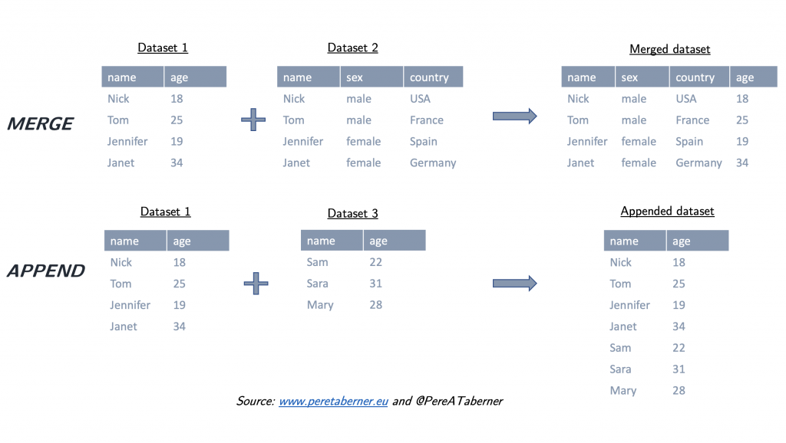
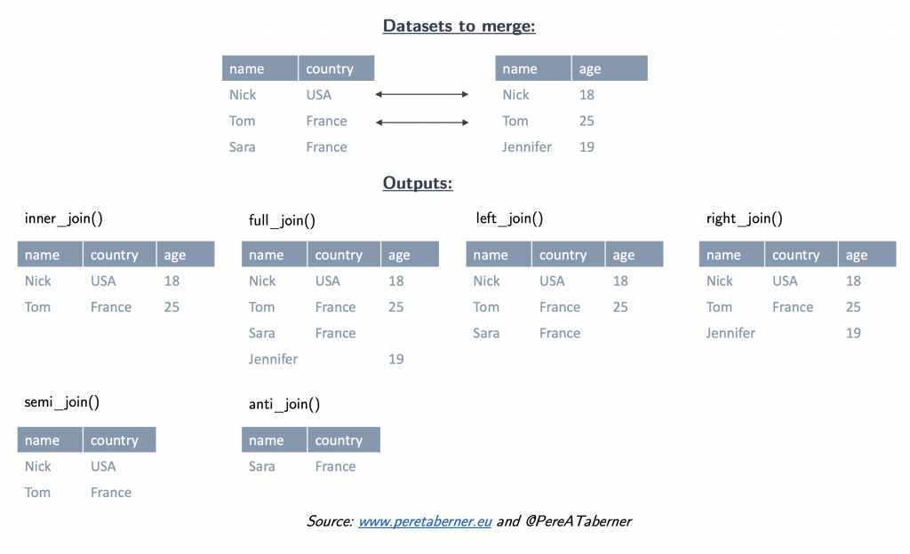
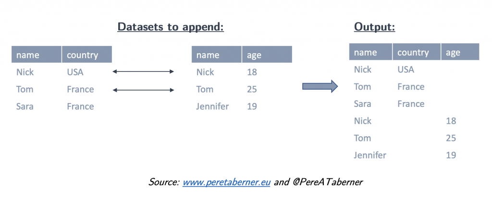

## Introduction

This brief post aims at explaining **how to merge and append datasets with R**, concretely with the package `dplyr`. First of all, it is important to have installed and loaded the library, i.e. `install.packages("dplyr")` and `library(dplyr)`.

```r
library(dplyr)
```

Before starting, the following illustration visually describes the definition of **merge** and **append** in the present post:



## Merge functions

In this post I explain six useful functions in `dplyr` to **merge datasets** and one useful function to **append datasets**. First, I describe briefly the six merging functions (each function joins two indicated datasets):

- `inner_join()`: the output dataset only contains **matched** observations from both initial datasets.
- `full_join()`: the output dataset contains **all** observations from both initial datasets.
- `left_join()`: the output dataset contains **all** observations from the **first** (or left) dataset indicated and only **matched** observations from the **second** (or right) dataset indicated.
- `right_join()`: the output dataset contains only **matched** observations from the **first** (or left) dataset indicated and **all** observations from the **second** (or right) dataset indicated.
- `semi_join()`: the output dataset only contains **matched** observations from the **first** (or left) dataset indicated (this includes **only the variables** from the **left** dataset).
- `anti_join()`: the output dataset only contains **NOT matched** observations from the **first** (or left) dataset indicated (and also **only the variables** from the **left** dataset).

The following illustration summarised visually these merging functions:



## Append function

Second, the function to **append two datasets**:

- `bind_rows()`: this is the verb to append two datasets, i.e. all the rows and variables from the two datasets.



## Practise - merge

I first create two small datasets to practise:

```r
id <- c(1:5)
names <- c("Paul", "Sara", "John", "Sandra", "Helen")
years <- c("24", "30", "45", "29", "18")

people <- data.frame(id, names)
age <- data.frame(id, years)
```

The syntaxis for the six merging functions is exactly the same, but we must take into account that the output will be different according to the description in the previous section. For example, I want to merge `people` and `age` datasets with `inner_join()`:

```r
# Merge the two datasets by "id" variable
output_dataset <- inner_join(people, age, by = "id")
```

- The result is a data frame named `output_dataset`. Since I have used `inner_join()`, only matched observations from the two datasets remain.
- `people` is the first (or left) dataset to merge.
- `age` is the second (or right) dataset to merge.
- I indicate the variable which connects both datasets with `by =`. In this example, I merge two datasets by one variable, but merging datasets by several variables is also possible.

The merging variable (called `id` in this example) might be labelled different in each dataset. If this would be the case, I must write the `by =` syntax as follows:

```r
# Rename the id variable in age dataset to show this example:
age <- rename(age, age_id=id)
```

```r
output_dataset <- inner_join(people, age, by = c("id" = "age_id"))
```

The first variable `id` corresponds to the first (or right) dataset, i.e. `people`, and the second variable `age_id` corresponds to the second one, i.e. `age`.

Morever, the two initial datasets might have two different variables but with the same name. I can label each of these variable to know where it comes from with `suffix =`:

```r
# New variable in each dataset with the same name but different values to show this example:
random1 <- c("a", "2", "c", "8", "a")
random2 <- c("d", "23", "c", "8a", "a")

# Prepare people dataset for this example
people <- data.frame(id, names, random1)
people <- rename(people, random=random1)

# Prepare `age` dataset for this example
age <- data.frame(id, years, random2)
age <- rename(age, random=random2)
```

```r
# Then, merge these two datasets
output_dataset <- inner_join(people, age, by = "id", suffix=c("_people", "_age"))
```

The first element in `suffix`, `"_people"`, is for the variables in the first dataset `people` and the second element, `"_age"`, for variables in the second dataset, `age`. Remember that these suffixes will be added only in those variables with the same name in both datasets. In case of not specifiying these suffixes, R would add `".x"` for the first dataset and `".y"` for the second one.

Note that in case of wanting to join more than two datasets, I must repeat the function as many times as datatsets I want to join. For example, to merge three datasets:

```r
# Create a third dataset:
location <- c("Spain", "Germany", "France", "France", "Italy")
country <- data.frame(id, location)
```

```r
output_dataset <- people %>%
  inner_join(age, by = "id") %>%
  inner_join(country, by = "id")
```

## Practise - append

Finally, to **append** two datasets:

```r
output_dataset <- people %>%
  bind_rows(age)
```

Now, let’s practice the other merge functions by yourself with these datasets and try to append more than three datasets. Good luck!!
