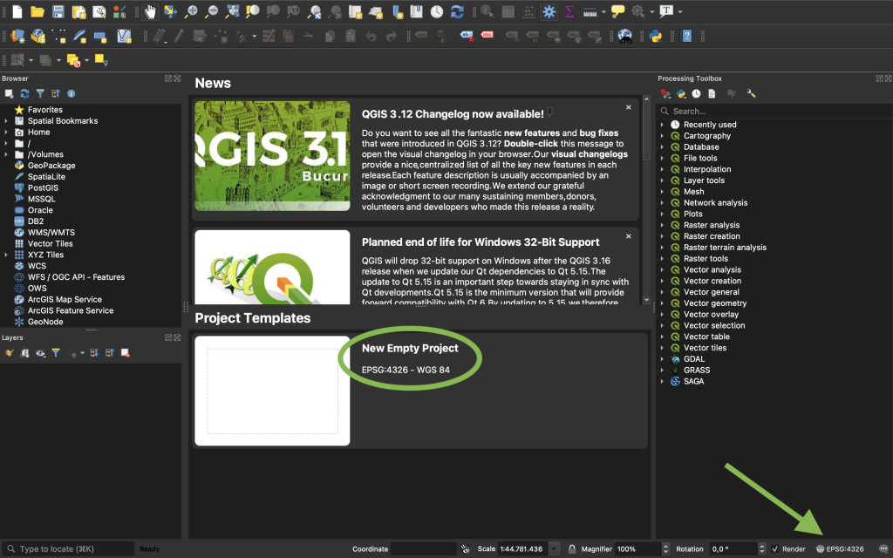
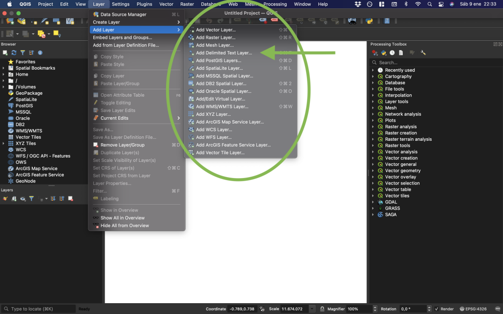
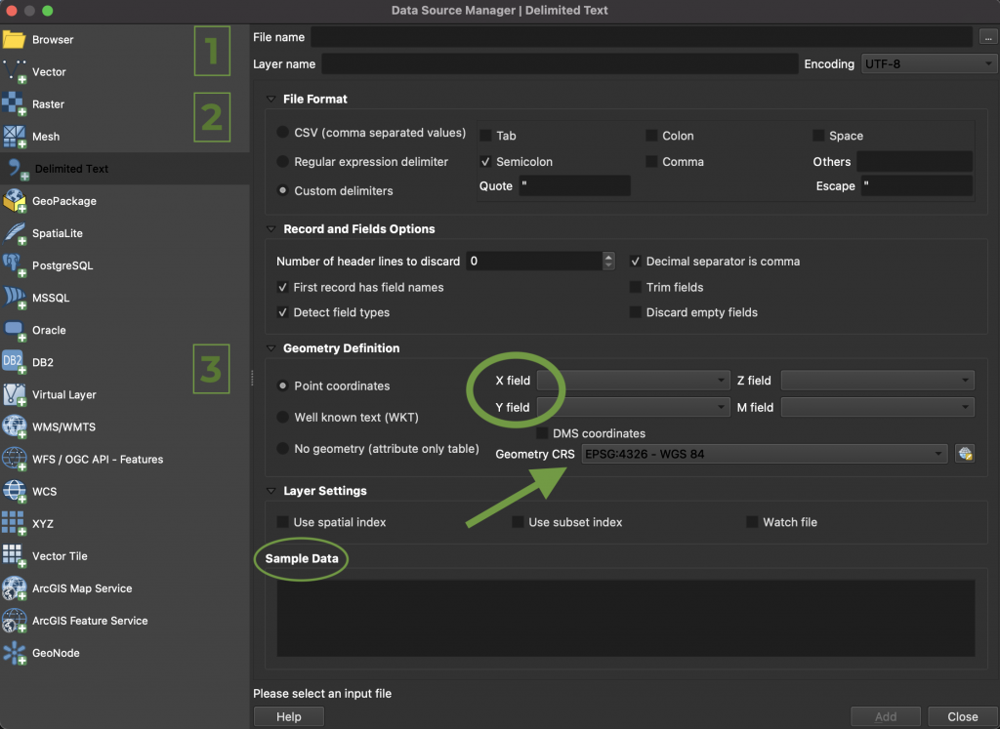
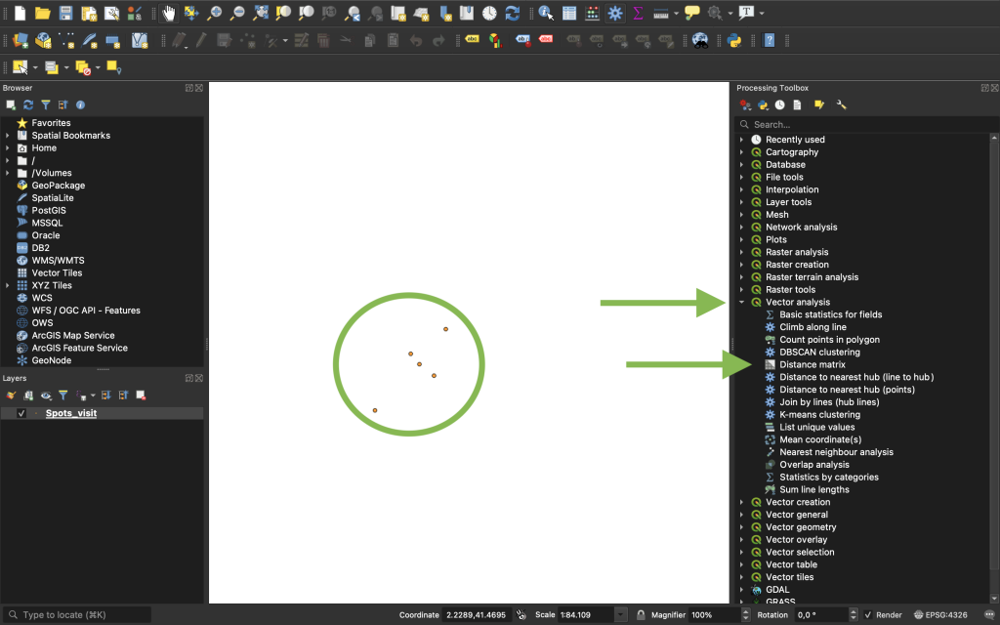
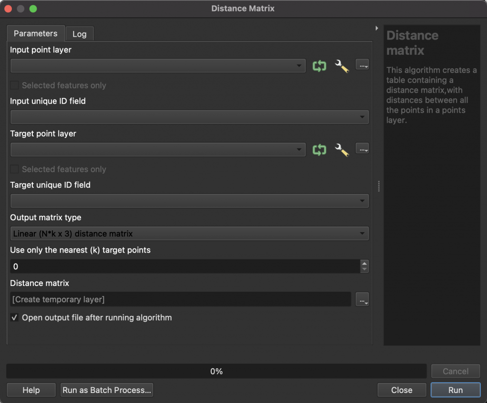

Managing geodata has become more common over last decades. [QGIS](https://www.qgis.org/en/site/) is an open source Geographic Information System (GIS) application which allows to **manage geospatial data and perform spatial analysis**. It is a project of the Open Source Geospatial Foundation (OSGeo) and it is available for Unix, Linux, Windows, MacOS and Android. The two main features of QGIS are (i) **free of charge** and (ii) **user-friendly**. Precisely, in the present post I explain how to compute distances between given geolocations in few steps for these who have never used QGIS. Concretely, geolocations stored in two csv files. So, let's start!

## 1. Install QGIS on your computer

First of all, of course, you must have installed the application in your computer. At the beginning of the previous paragraph you might find the url to the official webpage, and there, you can download the installation file. Therefore, once installed, open QGIS application.

## 2. Set the CRS of the workspace

First, start a new empty project (green circle in *Screenshot 1*). Before starting, it is important to set the **Coordinate Reference System (CRS)** of the workspace. This is a key step to eventually obtain the distances in the units that you want. The green arrow (bottom right in *Screenshot 1*) points the place where the default CRS can be changed to the desired one. For more information about CRS I would suggest to check the following [webpage](https://docs.qgis.org/3.16/en/docs/gentle_gis_introduction/coordinate_reference_systems.html#coordinate-reference-system-crs-in-detail) or [this one](https://datacarpentry.org/organization-geospatial/03-crs/). In this example, we will use the World Geographic System 1984 projection (also known as WGS 84), which is referenced with the [European Petroleum Survey Group (EPSG)](http://wiki.gis.com/wiki/index.php/European_Petroleum_Survey_Group) code 4326.

*Screenshot 1*

## 3. Import the geolocations

First of all, the two files with the geolocations must be imported.

Go to the top toolbar and select ***Layer* -\> *Add Layer*** (*see* *Screenshot 2*). There is plenty of different possible file formats, but in this example I explain how to import csv files. Then, you need to click on ***"Add Delimited Text Layer..."***.

*Screenshot 2*

After clicking, a window, like *Screenshot 3,* appears. Here it is important to indicate properly:

1.  Where is the file in your computer ***"File name"*** (click on the three dots to open a window) and put a name ******"Layer name"******.
2.  How are the columns separeted, i.e. the separators of the csv file. In case you are not sure, you can try different formats and check whether the data looks nice in the ***"Sample Data"*** box.
3.  The variables which contains the X and Y coordinates (***"X field"*** and ***"Y field"***) and the CRS of these coordinates (***"Geometry CRS"***). In this step, it does not matter whether the CRS of the coordinates is different from the desired one, QGIS will convert automatically when importing the layer to the workspace.

Thus, when these paramaters are already set, you can import the file to the workspace by clicking ***Add"*** (bottom right). Then, the locations appear in your workspace, such as in *Screenshot 4*. The same process must be done to import the other file.

*Screenshot 3*

## 4. Compute the distance matrix

Finally, you are ready to compute the distances between the targeted geolocations. For that, in the right column of the workspace, ***"Processing Toolbox"***, select ***Vector Analysis* -\> *Distance Matrix***, as *Screenshot 4* indicates.

*Screenshot 4*

A window like *Screenshot 5* appears. You need to indicate one layer (one of the csv files) in ***"Input point layer"*** and the other in **"Target point layer"** (the other csv file). This step is important because, in the distance matrix, the locations from the ***"Input point layer"*** will be as rows and the locations from ***"Target point layer"*** will be as columns. Therefore, each cell will indicate the distance between these two locations.

Then, in each layer, you must indicate the variable which uniquely identify each location, this is ***"Input unique ID field"*** for the input layer and ***"Target unique ID field"*** for the target layer. Then, I would suggest to indicate ***"Standard (NxT) distance matrix"*** in the ***"Output matrix type"*** in order to obtain a rectangular matrix. In case of opting for a ***"Linear (N\*k x 3) ditance matrix"*** you will get a file or layer with three columns (one colum with the input locations, one column with the target locations and one column with the distances between locations).

Finally, you might decide where and how to save the output. I usually choose ***"Save to a file..."*** in the desired foder in my computer and as csv file. Then, click ***"Run"*** and QGIS will compute distances and store the file as you have indicated.

*Screenshot* 5

## Bonus: compute distance matrix from the same layer/file

In case you want to compute distances between geolocations stored in the same file, you only have to indicate the same layer/file in the input and target layers and the same unique ID field. *"Et voilà!"*
